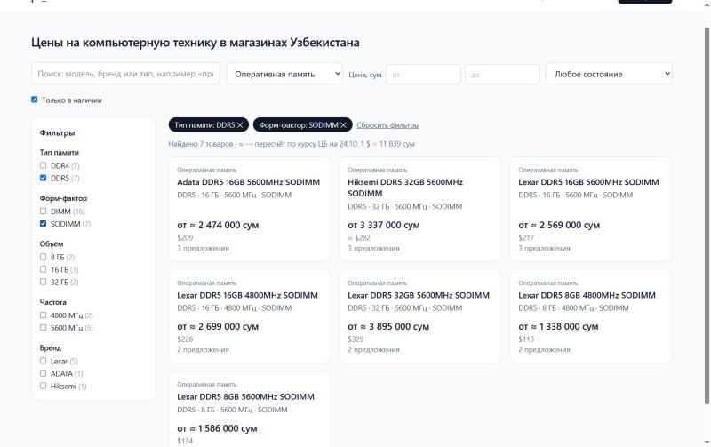
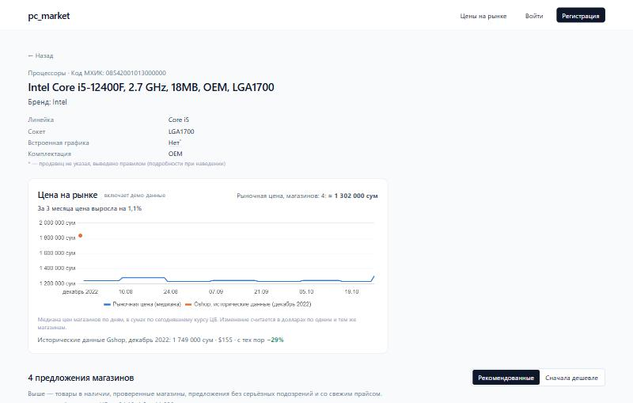
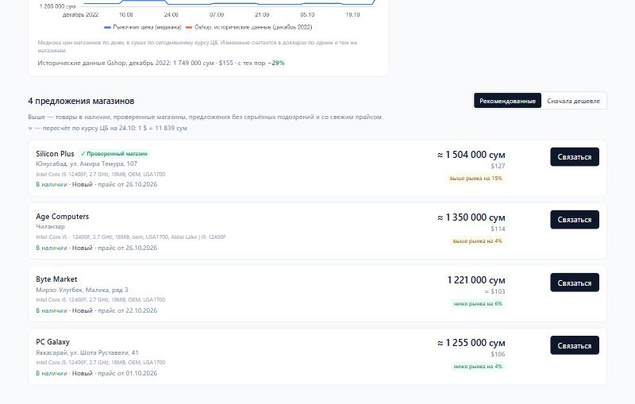
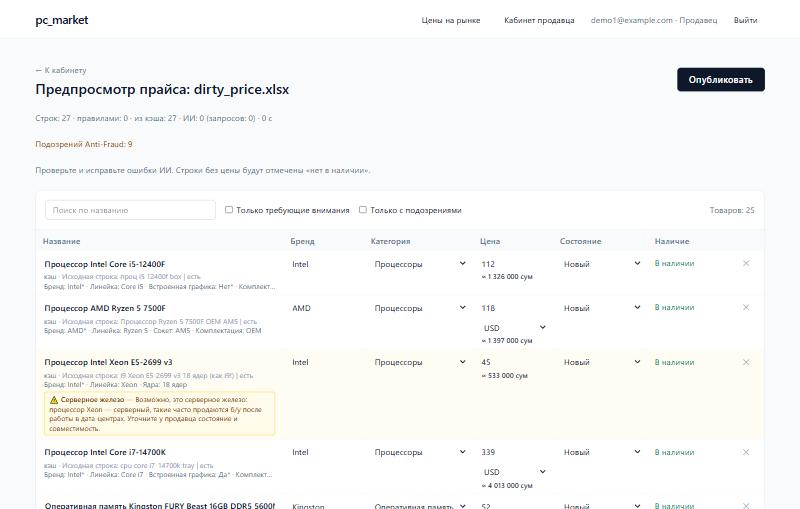
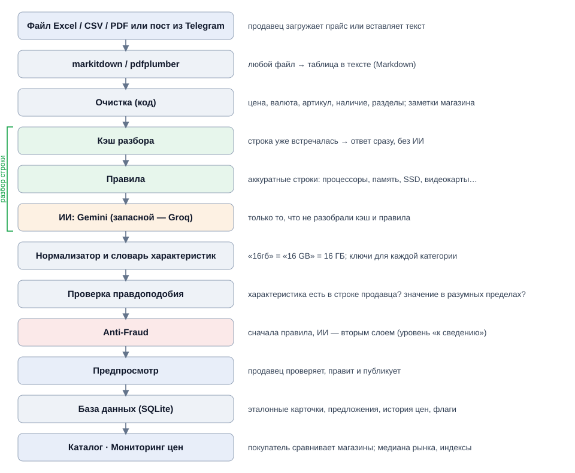

# pc_market

Информационная система мониторинга и стандартизации рынка компьютерной техники Узбекистана: магазины загружают прайсы в любом виде, система приводит их к единому каталогу, проверяет подозрительные предложения и показывает рыночные цены.

> Дипломный проект (рабочее название). Бета-версия, интерфейс на русском.
>
> **Демо-версия онлайн: https://pcmarket.khudoberdi.uz** — магазины и часть цен демонстрационные. Как устроено размещение и как обновить сайт — [docs/deploy.md](docs/deploy.md).

| Каталог с фильтрами по характеристикам | Карточка товара: рыночная цена и история |
|---|---|
|  |  |
| **Предложения магазинов с метками рынка** | **Предпросмотр «грязного» прайса с плашками Anti-Fraud** |
|  |  |

## Возможности

- **Загрузка прайса как есть:** Excel (объединённые ячейки, несколько таблиц на листе), CSV в любой кодировке, PDF, посты из Telegram на русском и узбекском, ручное добавление через поиск по каталогу.
- **Стандартизация:** эталонная карточка товара с кодом МХИК (из справочника tasnif.soliq.uz) и характеристиками по словарю для 23 категорий; предложения всех магазинов на одной странице.
- **Честные данные:** цену, валюту, артикул и наличие берёт код, а не ИИ; характеристика сохраняется, только если она есть в строке продавца или однозначно из неё следует.
- **Anti-Fraud:** серверное железо под видом игрового, противоречия в характеристиках (DDR4/DDR5, «GTX 3060»), флешки «на 2 ТБ», б/у под видом нового, цена сильно ниже рынка. Сначала правила, ИИ — вторым слоем; формулировки мягкие.
- **Предпросмотр перед публикацией:** продавец видит, как система поняла каждую строку, и может поправить; правки запоминаются.
- **Мониторинг цен:** рыночная цена (медиана), метки «ниже/выше рынка», график цены, индексы категорий, архив цен 2022 года, аналитика для продавца.
- **Валюты:** цена хранится в валюте продавца (USD или UZS), покупателю показывается в сумах по курсу ЦБ (cbu.uz).
- **Фильтры и поиск** по характеристикам: тип памяти, форм-фактор, сокет, встроенная графика и т. д.

## Архитектура



Разбор строки: **кэш → правила → ИИ** (Gemini, при исчерпании квоты — Groq). Повторная загрузка того же прайса не делает ни одного запроса к ИИ.

## Технологии

- **Backend:** Python 3.12, FastAPI, SQLAlchemy, SQLite, JWT (passlib/bcrypt)
- **Разбор файлов:** markitdown, pdfplumber, openpyxl
- **ИИ:** Google Gemini (основной), Groq (запасной) — на бесплатных лимитах
- **Frontend:** React (Vite), Tailwind CSS, react-i18next, Chart.js
- **Тесты:** pytest (без живых запросов к ИИ)

## Ключевые цифры

| Показатель | Значение |
|---|---|
| Реальный прайс магазина: разбор без кэша | 2 438 строк за 272 с (было ≈20–25 мин), 0 потерянных строк |
| Повторная загрузка | 0 запросов к ИИ, секунды |
| Точность (правила + Gemini): категория / бренд / модель | 100% / 99,6% / 97,5% |
| Цена и валюта | 100% |
| Строка попала в правильную карточку | 95,8% (было 71,6%) |
| Anti-Fraud | 22 из 22 подвохов, 0 ложных флагов на 1 142 чистых строках |

## Как запустить (Windows)

Нужны Python 3.12+ и Node.js 20+.

```bash
cd backend
python -m venv .venv
.venv\Scripts\python.exe -m pip install -r requirements.txt
```

Создать файл `backend/.env` (в репозиторий не попадает):

```
JWT_SECRET=           # любая длинная случайная строка
GEMINI_API_KEY=       # бесплатный ключ: https://aistudio.google.com/apikey
GROQ_API_KEY=         # бесплатный ключ (запасной провайдер): https://console.groq.com/keys
```

Запуск: `start.bat` в корне — откроются backend (http://127.0.0.1:8000, документация API — `/docs`) и сайт (http://localhost:5173). Остановить — `stop.bat`. При первом запуске база и справочник категорий создаются сами; frontend-пакеты ставятся автоматически.

Тесты:

```bash
cd backend
.venv\Scripts\python.exe -m pytest
```

Демо-режим `demo.bat` собирает базу с нуля из реального прайса и демо-магазинов; сам прайс в репозиторий не входит. Файлы для живой демонстрации — `samples/demo/`.

## Документация

- [docs/experiment.md](docs/experiment.md) — замер точности разбора (набор данных, методика, результаты)
- [docs/defense.md](docs/defense.md) — устройство проекта простым языком, цифры, вопросы и ответы
- [docs/demo_script.md](docs/demo_script.md) — сценарий показа
- [docs/roadmap.md](docs/roadmap.md) — дорожная карта
