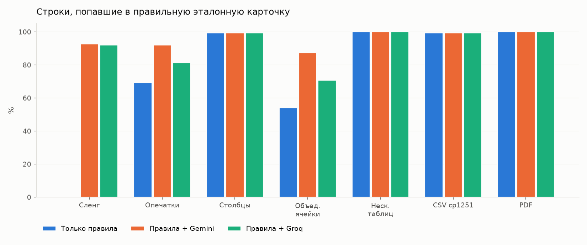
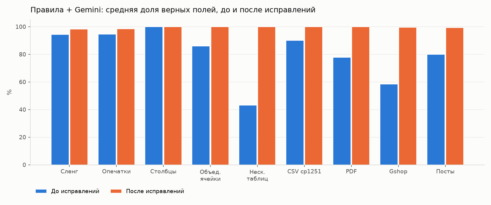
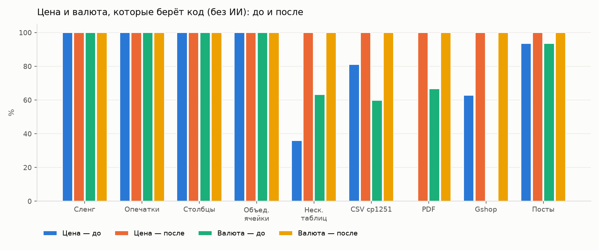

# Экспериментальная часть: точность разбора прайсов и постов

*Фаза 7, 26.10.2026. Все числа получены скриптом `backend/scripts/benchmark_parser.py suite` на наборе `backend/tests/benchmark/`; полные таблицы — `backend/tests/benchmark/results/tables.md`.*

## 1. Цель эксперимента

Проверить на данных с заранее известными правильными ответами, насколько точно система:

1. разбирает «грязные» прайс-листы и посты из Telegram — категория, бренд, модель, цена, валюта, состояние, характеристики;
2. сводит строки разных магазинов в одну эталонную карточку товара (на этом держится сравнение цен);
3. находит подозрительные предложения (Anti-Fraud) и не поднимает ложных тревог;

а также сравнить конфигурации: только правила, правила + Gemini, правила + Groq и ИИ без проверки характеристик по строке. Найденные слабые места исправлялись **общими правилами** (а не заплатками под файл), после чего замер повторялся.

## 2. Набор данных

| Часть | Объём | Откуда правильный ответ |
|---|---|---|
| Синтетические «грязные» прайсы | 7 файлов, 1063 строки | Из чистой строки реального прайса Age Computers, которую правила разбирают полностью |
| Подвохи для Anti-Fraud | 13 строк + 3 строки «цена ниже рынка» | Задан при создании |
| Gshop (декабрь 2022) | 70 случайных позиций из 1316 | Размечено вручную по исходной строке |
| Посты Telegram | 26 постов: 31 товар + 4 поста без модели | Размечено вручную |

**Синтетика.** Взяты 534 строки прайса Age Computers из 7 категорий (процессоры, ОЗУ, SSD, HDD, материнские платы, видеокарты, мониторы), которые правила разбирают однозначно — правильный ответ известен. Из них сделаны 7 испорченных версий по ~150 строк:

| Файл | Что испорчено |
|---|---|
| `s1_slang.xlsx` | Сленг и сокращения: «видюха», «проц», «озу», «мать», «моник», бренды по-русски («асус», «гигабайт»), «16гб», «3200» без МГц; цены «110$», «110 у.е.» |
| `s2_typos.xlsx` | Опечатки в брендах (SAPPHRIE, ASSUS, Lexsar, Gigabyet), кириллица внутри кодов («RТX5060», «РХG27Q»), лишние/пропущенные пробелы |
| `s3_columns.xlsx` | Столбцы в другом порядке, безымянный столбец, второй лист без шапки |
| `s4_merged.xlsx` | Объединённые ячейки: заголовок раздела на всю ширину, бренд объединён на несколько строк; цены в сумах |
| `s5_multitable.xlsx` | Две таблицы «наименование | цена» рядом и третья ниже, строка «Оплата только в национальной валюте!!!»; цены «1 250 000», «1.250.000 сум» |
| `s6_csv_cp1251.csv` | CSV с «;» в кодировке cp1251; в одном столбце «1 250 000 сум», «1.250.000 сум», «110$», «110 у.е.», «110,00» |
| `s7_pdf.pdf` | Таблица в PDF, цены «110$» и «1 250 000 сум» |

Цены сдвинуты случайно на 0–10%, чтобы не публиковать реальный прайс магазина. Курс для пересчёта зафиксирован: 1 $ = 11 850 сум.

**Подвохи** (известный правильный флаг): Xeon под видом i9, китайская плата X99 с Xeon, память ECC REG, «DDR5» в названии и DDR4 в артикуле, несуществующая «GTX 3060», видеокарта NO LHR, флешка 2 ТБ за $15, SSD 4 ТБ за $40, опечатка «600MHz» у DDR5, монитор «1440Hz», noname-блок питания за $12, RX 580 «после майнинга», P106-100; ещё 3 обычные строки с ценой 35% от рынка. Кроме того, у 6 обычных строк флаг правильный по самому прайсу (KingBank DDR5/DDR4, GTX 2060 Super) — всего 22 строки с ожидаемым флагом.

**Gshop** — прайс закрывшегося магазина за декабрь 2022: на листе три таблицы бок о бок, у каждой свои разделы, характеристики через «\», кириллица в моделях, опечатки («Curverd»), много периферии (коврики, клавиатуры, рули), которой нет среди синтетики.

**Посты** — 9 постов из фикстур проекта и 13 реальных постов, скопированных из Telegram-групп (обезличены: телефоны, @юзернеймы, имена и ссылки заменены вымышленными; оригинал не в репозитории), плюс 4 поста без модели («Топовая видюха, пишите в лс», «Продаю комп, цена договорная», «Продаю видеокарту… 150$», «Оперативка есть, 16гб… 35$»). В реальных постах — две цены («120У.Е. 115У.Е.», «15$ / Подписчикам 13$»), цена без валюты («Цена 140.000»), телефоны, числа-шум («6pin», «192-bit», «68-69°»), узбекский латиницей и кириллицей, «openbox», сравнение с другой моделью («Пизже i5-12400f»).

## 3. Методика

- **Холодный прогон**: каждый набор разбирается с пустым кэшем (база в памяти; рабочий кэш не трогается) — тем же конвейером, что в программе: файл → очистка кодом → правила → ИИ → нормализация характеристик.
- **Поля**: категория, бренд (с учётом написания: «GIGABYTE» = «Gigabyte»), модель (верно, если совпадает с эталонной или с кодом модели/артикулом из чистой строки), цена (±0,5%), валюта, состояние. Для каждого поля считаются доля верных, доля заполненных и доля незаполненных.
- **Сведение карточек**: строка попала в правильную эталонную карточку, если ключ сведения её товара совпал с ключом эталона (как при публикации).
- **Характеристики**: по размеченным ключам — верно / неверное значение / нет; отдельно «лишние» (нет в разметке) и значения ИИ, которые отсекла проверка по строке.
- **Anti-Fraud**: подвох пойман, если поднят ожидаемый тип флага; ложный флаг — флаг уровня «внимание» или «важно» на строке, где флага быть не должно.
- **Ресурсы**: время, число запросов к ИИ, сколько строк разобрано правилами и сколько ушло в ИИ.
- **Повторяемость и бюджет**: ответы ИИ записываются построчно (`results/ai_gemini.json`, `ai_groq.json`). Повторный замер после исправлений спрашивает ИИ только о строках, текст которых изменился, остальное берёт из записи. Поэтому весь эксперимент уложился в бесплатные лимиты за один день: Gemini — 16 запросов «до» и 8 «после» (лимит — 20 в сутки на каждую из трёх моделей), Groq — 37 запросов (лимит — 1000 в сутки, 8 000 токенов в минуту).
- Конфигурация «Gemini без проверки» использует те же ответы Gemini, но не отсекает характеристики, которых нет в строке продавца — так видно, что именно отсекает проверка.

## 4. Результаты

### 4.1. Сравнение конфигураций (после исправлений, все наборы: 1063 + 70 + 31 строка)

| Показатель | Только правила | Правила + Gemini | Правила + Groq | Gemini без проверки |
|---|---|---|---|---|
| Категория, % верных | 69,5 | **100,0** | 99,7 | 100,0 |
| Бренд, % | 68,6 | **99,6** | 98,5 | 99,6 |
| Модель, % | 63,4 | 97,5 | **97,9** | 97,5 |
| Цена, % | **100,0** | 100,0 | 100,0 | 100,0 |
| Валюта, % | **100,0** | 100,0 | 100,0 | 100,0 |
| Состояние, % | 99,9 | 99,9 | 100,0 | 99,9 |
| Строка попала в правильную карточку, % (синтетика) | 74,6 | **95,8** | 91,8 | 95,8 |
| Характеристики, % верных из размеченных | 71,7 | 94,5 | 94,4 | 95,0 |
| Характеристики с неверным значением | 5 | 8 | 8 | 8 |
| Лишние характеристики (нет в разметке) | 20 | 76 | 69 | **113** |
| Anti-Fraud: поймано подвохов | 19 из 22 | **22 из 22** | 22 из 22 | 22 из 22 |
| Ложные флаги на чистых строках | 0 из 1142 | **0 из 1142** | 2 из 1142 | 0 из 1142 |
| Строк разобрано правилами / ушло в ИИ | 794 / 384 | 794 / 384 | 794 / 384 | 794 / 384 |
| Не распознано | 384 | 0 | 0 | 0 |

*Правила без ИИ распознают 67% строк (794 из 1178) — аккуратные строки поставщиков; остальные 384 строки остаются в предпросмотре с пометкой «не распознано» (цена и валюта при этом уже верные — их берёт код).*



*Рис. 1. Доля строк, попавших в правильную эталонную карточку. Без ИИ сленг не сводится вообще (0%): правила понимают только аккуратные строки.*

### 4.2. По типам данных (правила + Gemini, после исправлений)

| Набор | Строк | Категория | Бренд | Модель | Цена | Валюта | Состояние | Карточка | Характ. |
|---|---|---|---|---|---|---|---|---|---|
| Сленг | 155 | 100,0 | 100,0 | 89,8 | 100,0 | 100,0 | 100,0 | 92,7 | 65,2 |
| Опечатки | 154 | 100,0 | 97,4 | 93,2 | 100,0 | 100,0 | 100,0 | 92,0 | 96,0 |
| Столбцы | 150 | 100,0 | 100,0 | 100,0 | 100,0 | 100,0 | 100,0 | 99,3 | 99,7 |
| Объединённые ячейки | 150 | 100,0 | 100,0 | 100,0 | 100,0 | 100,0 | 100,0 | 87,3 | 99,8 |
| Несколько таблиц | 150 | 100,0 | 100,0 | 100,0 | 100,0 | 100,0 | 100,0 | 100,0 | 99,8 |
| CSV cp1251 | 154 | 100,0 | 100,0 | 100,0 | 100,0 | 100,0 | 99,4 | 99,3 | 100,0 |
| PDF | 150 | 100,0 | 100,0 | 100,0 | 100,0 | 100,0 | 100,0 | 100,0 | 99,8 |
| **Gshop** | 70 | 100,0 | 98,6 | 98,6 | 100,0 | 100,0 | 100,0 | — | 94,3 |
| **Посты** | 31 | 100,0 | 100,0 | 96,3 | 100,0 | 100,0 | 100,0 | — | 100,0 |

У сленга характеристики 65%: в сленговой строке часть данных просто потеряна («3200» без МГц, нет артикула), и система честно их не додумывает. Посты без модели: **4 из 4** не создали карточку, продавец получил сообщение «Не нашли модель товара…».

### 4.3. До и после исправлений

| Показатель (все наборы) | Правила — до | Gemini — до | Правила — после | Gemini — после |
|---|---|---|---|---|
| Категория, % | 59,6 | 87,7 | 69,5 | **100,0** |
| Бренд, % | 57,2 | 81,5 | 68,6 | **99,6** |
| Модель, %* | 54,4 | 71,0 | 63,4 | **97,5** |
| Цена, % | 74,0 | 73,4 | **100,0** | **100,0** |
| Валюта, % | 79,5 | 85,3 | **100,0** | **100,0** |
| Состояние, % | 92,9 | 93,0 | 99,9 | 99,9 |
| Строка попала в правильную карточку, % | 61,1 | 71,6 | 74,6 | **95,8** |
| Характеристики, % | 60,6 | 83,8 | 71,7 | 94,5 |
| Подвохов поймано | 18 из 23 | 20 из 23 | 19 из 22 | **22 из 22** |
| Ложных флагов | 15 | 13 | 0 | **0** |

\* В замере «до» модель считалась только по эталонной модели, «после» — ещё и по коду/артикулу из чистой строки (обе формы правильные; см. п. 3). Остальные показатели считались одинаково. Число подвохов 23 → 22: в сленговой строке KingBank нет артикула с «DDR4», поэтому противоречие DDR5/DDR4 в ней больше не видно и флаг там не ожидается.



*Рис. 2. Средняя доля верных полей по наборам. Сильнее всего выросли «несколько таблиц на листе» (42 → 100%), Gshop (58 → 99%), PDF (78 → 100%) и посты (80 → 99%).*



*Рис. 3. Цена и валюта, которые берёт код (без ИИ), до и после. ИИ цену не трогает, поэтому все ошибки цены были ошибками кода — и исправлялись кодом.*

### 4.4. Gemini и Groq

- **Качество** на одних и тех же 384 строках близкое: категория 100 / 99,7%, бренд 99,6 / 98,5%, модель 97,5 / 97,9%. Разница — в сведении карточек (95,8 / 91,8%): Groq чаще дописывает в название лишнее (объём кэша процессора «33MB», слова после кода модели) и реже исправляет опечатки в брендах. У Groq 2 ложных флага: внешний SSD Transcend он отнёс к флешкам (→ «флешка 2 ТБ — подозрительно»), опечатку «600МHz» исправил на 6000 в названии.
- **Скорость** (с бесплатными лимитами): Gemini — 16 запросов, 459 с на 479 строк «до» (ограничение 5 запросов в минуту, одна часть до 400 строк); Groq — 30 запросов, 683 с на 384 строки (части по 60 строк, ограничение 8 000 токенов в минуту, ожидания после ответов 429). Правила без ИИ разбирают весь набор (1178 строк) за ~7 с.
- **Устойчивость**: Groq присылал характеристики объектом `{"type": "DDR4"}` вместо списка строк — из-за этого целая часть из 60 строк падала после 5 попыток. Исправлено: разбор ответа принимает обе формы, неизвестные коды отбрасываются, а не роняют часть.
- **Вывод**: Gemini — основной провайдер, Groq — рабочий запасной (качество на уровне, но медленнее на бесплатном тарифе); именно так они и настроены.

### 4.5. Что отсекает проверка характеристик по строке

| | Gemini | Groq |
|---|---|---|
| Значений характеристик от ИИ | 1190 | 1225 |
| Отсечено проверкой (нет в строке продавца) | 175 (14,7%) | 219 (17,9%) |
| из них по разметке были бы верны | 111 | 125 |
| из них по разметке неверны | 6 | 22 |
| ключа нет в разметке (продавец этого не писал) | 58 | 72 |

Без проверки у Gemini лишних характеристик 113 вместо 76 (+49%), а верных из размеченных — 95,0 вместо 94,5%. То есть проверка консервативна: она отбрасывает и часть верных знаний ИИ (например, сокет LGA1700 у «проц i5 12400f» — верно, но продавец этого не писал), зато в карточку и в Anti-Fraud не попадает ничего, чего нет в строке продавца, и отсекаются все неверные догадки (6 у Gemini, 22 у Groq). Для площадки, где покупатель доверяет характеристикам, это правильный размен.

## 5. Найденные ошибки и исправления (общими правилами)

| Что было | Пример | Как исправлено |
|---|---|---|
| PDF-таблица читалась по столбцам: сначала все названия, потом все цены — 0% цен | `s7_pdf` | Таблицы PDF читаются построчно (pdfplumber); строка текста без таблицы — цена в конце строки |
| Несколько таблиц на листе: строка из двух товаров, цена соседа, раздел = «Оплата…» | `s5`, Gshop: цена Gshop 63%, бренд 0% без ИИ | Лист делится на области строками-заголовками; область с таблицами бок о бок → одна таблица «Раздел / Наименование / Цена / Примечание»; разделы в каждом блоке свои |
| Фраза магазина считалась разделом и не давала валюты | «Оплата производится только в национальной валюте!!!» | Убирается из таблицы и показывается продавцу как подсказка: «валюту проверьте сами» |
| Объединённая ячейка теряла бренд у строк ниже | `s4`: бренд 46% | Ячейка, объединённая вниз, принадлежит каждой своей строке; столбец «Бренд» дописывается к названию. На реальном прайсе Age так «нашлись» общие характеристики корпусов/БП и 5 цен Audio-technica |
| «1.250.000 сум» не читалось, валюта ячейки игнорировалась | `s6`: цена 81%, валюта 60% | Точки как разделитель тысяч у сумов, «110,00»; валюта берётся из ячейки («$», «у.е.», «сум»), без пометки — валюта загрузки |
| Символ «|» внутри ячейки ломал строку таблицы | Gshop: «Edifier R1080 BT … AUX | Bluetooth» без цены | Заменяется на «/» до чтения |
| ИИ (flash-lite) пропускал товары без подходящей категории как «не товары» | 15 из 70 позиций Gshop: коврики, кронштейн, руль, роутер | В промпте: такие товары не пропускать, а ставить «Прочее» |
| Ключ карточки ломался от описаний в названии ИИ | «… 4.7 GHz Granite Ridge», «IPS 270Hz FHD», «GDDR7 128bit», «RTX5060Ti» | В ключ не входят частоты, Гц, разрешения, матрица, GDDR, шина, мс, об/мин, сокет, M.2/SATA, артикул в скобках, кодовые имена, объём кэша, слова Gaming/GeForce; «16 ГБ» = «16GB», «RTX5060Ti» = «RTX 5060 Ti», кириллица в коде = латиница |
| ИИ выкидывал из названия то, что отличает товары | «Gigabyte B860M Gaming WiFi6» без «DDR5», процессор без «OEM» | Определяющие характеристики берутся из строки продавца: тип памяти платы, OEM/BOX, DDR у ОЗУ, частота монитора |
| Строка без частоты не находила карточку «… 240 Гц» | «моник titan army kg277s 27"» | «Единственное дополнение»: если в каталоге ровно одна карточка, отличающаяся только этой характеристикой, строка идёт в неё; две (Redmi G27Q 240 и 320 Гц) — новая карточка |
| Опечатки в брендах | SAPPHRIE, ASSUS, Lexsar, Gigabyet | Ровно одна правка известного бренда (от 5 букв). Первая версия с «похожестью ≥ 0,8» превращала Apacer в Acer и Vissonic в ViewSonic — найдено пересчётом базы и исправлено до применения |
| Бренд видеокарты «NVIDIA» у карты без производителя | «rtx 3060 12gb новая 290$» | NVIDIA/AMD/Intel у видеокарты — производитель чипа (характеристика), а не бренд, если не написан в строке |
| «1440Hz» читалось как 440 Гц, ловушка с опечаткой не срабатывала | `s6` | Число не вырезается из более длинного числа |
| Кулер с «заводской термопастой» получал тип «термопаста» | пост DeepCool AG300 | Вид товара — тот, что назван первым; жидкостное («CORELIQUID», «СЖО») — по любому упоминанию |
| «Без майнинга» давало флаг «после майнинга» | пост MSI RTX 3060 | Отрицания («без майнинга», «не майнила») убираются перед проверкой |
| Посты: «новый» без единого слова о состоянии, 2 товара из «15$ / Подписчикам 13$», «Цена 140.000» не цена, телефон — цена | реальные посты | Состояние только по явным словам (иначе «не указано» + подсказка), «новый, вскрытая упаковка» для openbox; две цены = товар + примечание; цена без валюты — по величине с подсветкой; служебные строки Telegram; «модель не указана» |

Ложные флаги «до» (15) почти все были следствием неверной цены, а не правил Anti-Fraud: в `s5` цена бралась из соседней таблицы — «цена ниже рынка» у 11 строк; в постах товар без слова о состоянии считался новым, а в тексте было «б/у» — «возможно, б/у» у 3 строк. После исправления цен ложных флагов 0.

## 6. Типичные оставшиеся ошибки

- **Мониторы: слова после кода модели.** Эталон «ASUS PA279CRV 27"», у ИИ — «ASUS ProArt PA279CRV 27"»; «Curved», «PLUS», «Odyssey G4». Это главная причина того, что `s4` сводится на 87%. Убрать такие слова из ключа опасно: «P275MS» и «P275MS PLUS» — разные модели. Оставлено как есть и записано в идеи на потом.
- **Артикулы без скобок** («HDD Toshiba … HDWT840UZSVA»): ИИ иногда их выбрасывает, и ключ не совпадает.
- **Сленг теряет данные**: «оперативка GMOC DDR4 16гб 3200» — частоту без «МГц» нормализатор не берёт, артикулы в сленге не пишут; характеристик 65%.
- **Опечатки в коротких брендах** (MCI вместо MSI, BneQ вместо BenQ) намеренно не исправляются: для слов короче 5 букв риск спутать настоящие бренды выше пользы.
- **Состояние у прайс-файлов** берётся «новый» по умолчанию: «RX 580 после майнинга» в прайсе осталось «новым» (флаг «майнинг» при этом поднят).
- **Groq**: внешний SSD → «флешка», лишние слова в названиях (см. 4.4).

## 7. Выводы

1. **Код, а не ИИ — для цены, валюты и состояния.** После исправлений цена и валюта верны в 100% строк во всех форматах (xlsx, CSV cp1251, PDF, посты), состояние — в 99,9%. Все ошибки цены «до» были ошибками кода, и ИИ их не исправил бы: он цену не видит.
2. **ИИ нужен для «понимания» названий.** Без ИИ категория и бренд верны в ~69% строк, сленг не распознаётся вообще; с Gemini — 99,6–100%.
3. **Сведение карточек — самое чувствительное место** (от него зависит сравнение цен): 61% → 96% после правила «описания не входят в ключ, определяющие характеристики берутся из строки продавца». На каталоге из 2399 карточек пересчёт ключей склеил только одну пару — и правильно (пост «Процессор Intel Core i5-13400 LGA1700 OEM» попал в эталонную карточку i5-13400).
4. **Anti-Fraud** ловит все 22 подвоха при 0 ложных флагов на 1142 чистых строках (с Gemini). Без ИИ — 19 из 22: правилам нужна категория (NO LHR проверяется только у видеокарт, noname — у блоков питания).
5. **Проверка характеристик по строке** отсекает ~15–18% значений ИИ, в том числе все неверные; цена — часть верных «знаний» ИИ, которых продавец не писал.
6. **Gemini и Groq** сопоставимы по качеству; Gemini точнее сводит карточки и быстрее на бесплатных лимитах — оставлен основным, Groq — запасным.
7. Весь эксперимент уложился в бесплатные лимиты за один день благодаря построчной записи ответов ИИ.

## 8. Ограничения (честно)

- **Посты с ценой только на картинке не поддерживаются** — текста цены нет, распознавание картинок (OCR) не делалось.
- **Посты без модели не распознаются — так и задумано**: «топовая видюха, пишите в лс» не превращается в мусорную карточку, продавец видит «модель не указана».
- **Синтетика построена из строк одного поставщика** и только 7 категорий, которые правила разбирают полностью; сведение карточек проверено только на синтетике (для Gshop и постов нет эталонного каталога). Gshop даёт другие категории (периферия), посты — живой текст.
- Правильный ответ синтетики — разбор чистой строки правилами; где правило само упрощает название (мониторы: название обрывается на коде модели), эталон тоже упрощён.
- Набор постов маленький (26 постов, 31 товар) — проценты по постам показывают направление, а не точную долю.
- Замер «до» для Gemini сделан частично на `gemini-3.5-flash`, частично на запасной `flash-lite` (суточная квота основной модели кончалась); «после» — повторно использованы те же ответы, новые строки — `flash-lite`. Время ИИ сильно зависит от бесплатных лимитов и очереди провайдера.
- Курс в эксперименте фиксированный (11 850 сум/$), «цена ниже рынка» проверялась по ценам двух условных магазинов.

## 9. Как повторить

```
cd backend
.venv/Scripts/python.exe tests/benchmark/make_dataset.py              # синтетика (нужен F:\claudy\samples)
.venv/Scripts/python.exe scripts/benchmark_parser.py suite --config rules --tag after
.venv/Scripts/python.exe scripts/benchmark_parser.py suite --config gemini --tag after          # по записанным ответам
.venv/Scripts/python.exe scripts/benchmark_parser.py suite --config gemini --live --tag after   # недостающие строки — живой ИИ
.venv/Scripts/python.exe tests/benchmark/report.py                    # таблицы и графики
```
